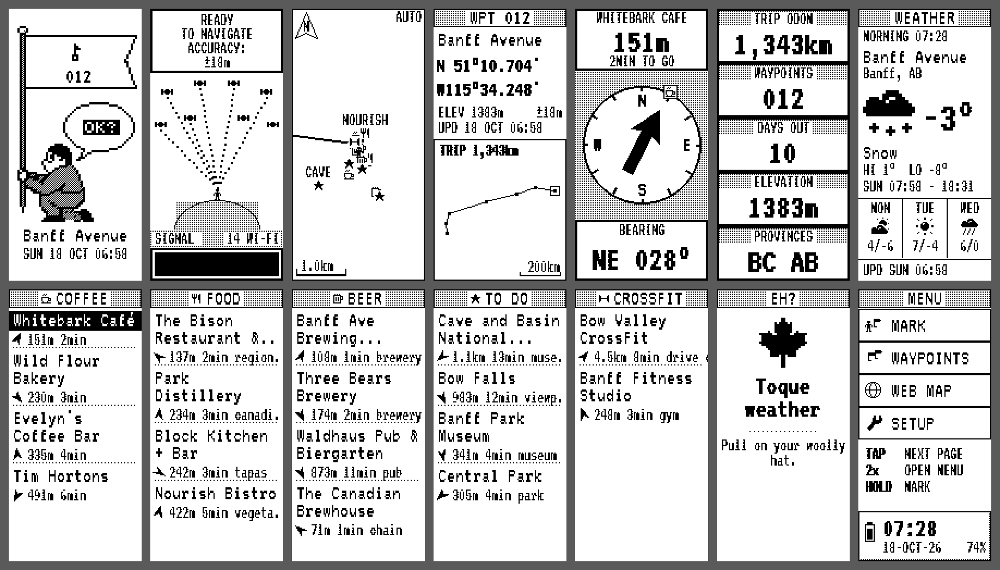

# Retro GPS



A Garmin eTrex H-style trip logger on a **Raspberry Pi Zero 2 W** with a **Waveshare 2.13" e-Paper HAT (V4)**, used upright (122×250, like the eTrex), and a **PiSugar 3** battery. It's the bigger sibling of the [Retro Canada Guide](https://github.com/nomaditect/retro-canada-guide) and does everything that does, with the eTrex's own pages added.

Four times a day (6am, 10am, 4pm and 8pm local time, wherever you are) it wakes up, joins your phone's hotspot, works out where you are from the Wi-Fi around you, marks a waypoint and finds coffee, food, craft breweries, things to do and CrossFit gyms nearby. Between those it does a quick Wi-Fi scan every hour in the daytime, so the route has breadcrumbs. The Pi is fully off the rest of the time: the PiSugar's clock wakes it.

## The button

The PiSugar has one button, so it stands in for the eTrex's keys:

| | On a page | In a menu |
|---|---|---|
| **Tap** | PAGE: next page | move down |
| **Double tap** | ENTER: this page's option | select |
| **Hold** | MARK: update now and mark a waypoint | back |

When the Pi is off, a tap turns it on. Holding the button for a long time asks it to power off.

## Pages

1. **Mark**: the little man from the original eTrex, planting this stop's flag. *2x: update now*
2. **SkyView**: the Wi-Fi networks it can hear, drawn as the eTrex's satellites, with READY TO NAVIGATE and the accuracy. While updating it shows what it's doing (SCANNING, LOCATING, NEARBY...). *2x: update now*
3. **Map**: you in the middle, north up, your trail, earlier waypoints and nearby places with their symbols, and a scale bar. *2x: zoom (auto, 200 m ... 500 km)*
4. **Waypoint**: coordinates Garmin-style (`N 51°10.704'`), elevation, accuracy and a plot of the route so far. *2x: list of all waypoints*
5. **Pointer**: a compass ring with a big arrow to your destination, the distance and the walking time. The Pi has no compass, so the ring is north-up: turn until its N faces real north. *2x: next destination*
6. **Trip Computer**: five eTrex boxes: trip distance, waypoints, days out, elevation and provinces. *2x: sunrise, sunset, next mark, battery and time*
7. **Weather**: neighbourhood, city and province, temperature, high and low, sunrise and sunset, and the next three days
8. **Coffee**, 9. **Food**, 10. **Beer**, 11. **To do**, 12. **CrossFit**: the nearest four, with distance, walking time and an arrow pointing the way. Local places rank above chains; on Beer, craft breweries (and Québec's microbrasseries) within 2 km come first, then local pubs; famous sights come first on To do. CrossFit looks 8 km out: CrossFit boxes first, then independent strength and fitness gyms (no yoga, spin or climbing studios), chains last. Anything over 3 km shows a rough driving time instead of a walk. *2x: GOTO the next one (it's highlighted, and the Pointer and Map point at it)*
13. **Eh?**: a Canadian saying picked to suit the province, the weather and the time of day. *2x: another one*
14. **Menu**: MARK, WAYPOINTS (pick one to GOTO), WEB MAP and SETUP (sync now, rotate screen, new trip, sleep now), with the time, date and battery

**Web map**: on your phone, scan the QR code (same Wi-Fi as the Pi) to see the whole trip on a map, with popups for each waypoint, or download it as GPX or GeoJSON. It stays on for 10 minutes; hold to stop.

The screen keeps its last picture while the Pi is off, so it always shows something useful.

## How it finds things

| What | Service | Key |
|---|---|---|
| Position (from nearby Wi-Fi) | [Google Geolocation API](https://developers.google.com/maps/documentation/geolocation), or [BeaconDB](https://beacondb.net) without a key | optional, but much more accurate |
| Coffee, food, beer, things to do, CrossFit | [Geoapify Places](https://www.geoapify.com/places-api), or OpenStreetMap's Overpass without a key | free key recommended |
| Weather, forecast, sunrise, elevation, time zone | [Open-Meteo](https://open-meteo.com) | none |
| Place names | [Nominatim](https://nominatim.org) (OpenStreetMap) | none |

If the position is only a rough guess (worse than 3 km), it says so and skips nearby places instead of guessing. Scans taken while offline are located the next time it's online.

## Setup

You need the Clopsagotchi card (or any Raspberry Pi OS Trixie card with the e-ink and PiSugar working) and a way onto the Pi: see [docs/mac-usb-connection.md](docs/mac-usb-connection.md).

1. `cp secrets.example.toml secrets.toml` and add your Wi-Fi networks (phone hotspot first) and keys. On an iPhone, turn on **Maximise Compatibility** in Personal Hotspot, because the Pi only joins 2.4 GHz here.
2. Copy the repo to the Pi and install:

```sh
rsync -a --exclude .git ./ pi@10.0.0.2:retrogps/
ssh pi@10.0.0.2 'cd retrogps && sudo ./install.sh && sudo reboot'
```

The installer switches off Clopsagotchi, turns Wi-Fi back on, saves the networks in NetworkManager and starts Retro GPS at boot. `sudo ./uninstall.sh` puts Clopsagotchi back (the trip logs stay).

While the Pi is plugged into a computer over USB it stays awake, so you can log in. To keep it awake on battery, create `/boot/firmware/retrogps-stay` on the SD card.

If the picture is upside down in your case, use **Menu > Setup > Rotate screen**.

Before a trip, use **Menu > Setup > New trip** to start a fresh log (the old one is kept on the card).

Optional: set `[github]` in `secrets.toml` to upload `trip.geojson` after every update. GitHub draws `.geojson` files as a map.

## Files on the Pi

| Path | What |
|---|---|
| `/var/lib/retrogps/state.json` | everything on screen, the schedule and the trip totals |
| `/var/lib/retrogps/fixes.jsonl` | every position: time, lat, lon, accuracy, waypoint number |
| `/var/lib/retrogps/wpts.jsonl` | every waypoint with its weather and nearby places |
| `/var/lib/retrogps/power.csv` | one row per wake, for working out battery life |
| `/etc/retrogps/secrets.toml` | Wi-Fi and keys |

## Development

On a Mac (Python 3.11+ with Pillow; `qrcode` optional):

- `python3 tools/preview.py preview.png` draws every page with made-up data from Banff
- `python3 -m unittest discover tests` runs the tests
- `RETROGPS_DATA=/tmp/rgps python3 -m retrogps.main --sim frame.png` runs the real app with the screen going to `frame.png`. Type `s`, `d` or `l` and Enter for a tap, double tap or hold. Updates need the Pi's Wi-Fi tools, so they fail on a Mac.

The font is [VT323](https://fonts.google.com/specimen/VT323) (SIL Open Font License). The landing art was traced from the original eTrex at its native pixel grid, for the Retro Canada Guide.
